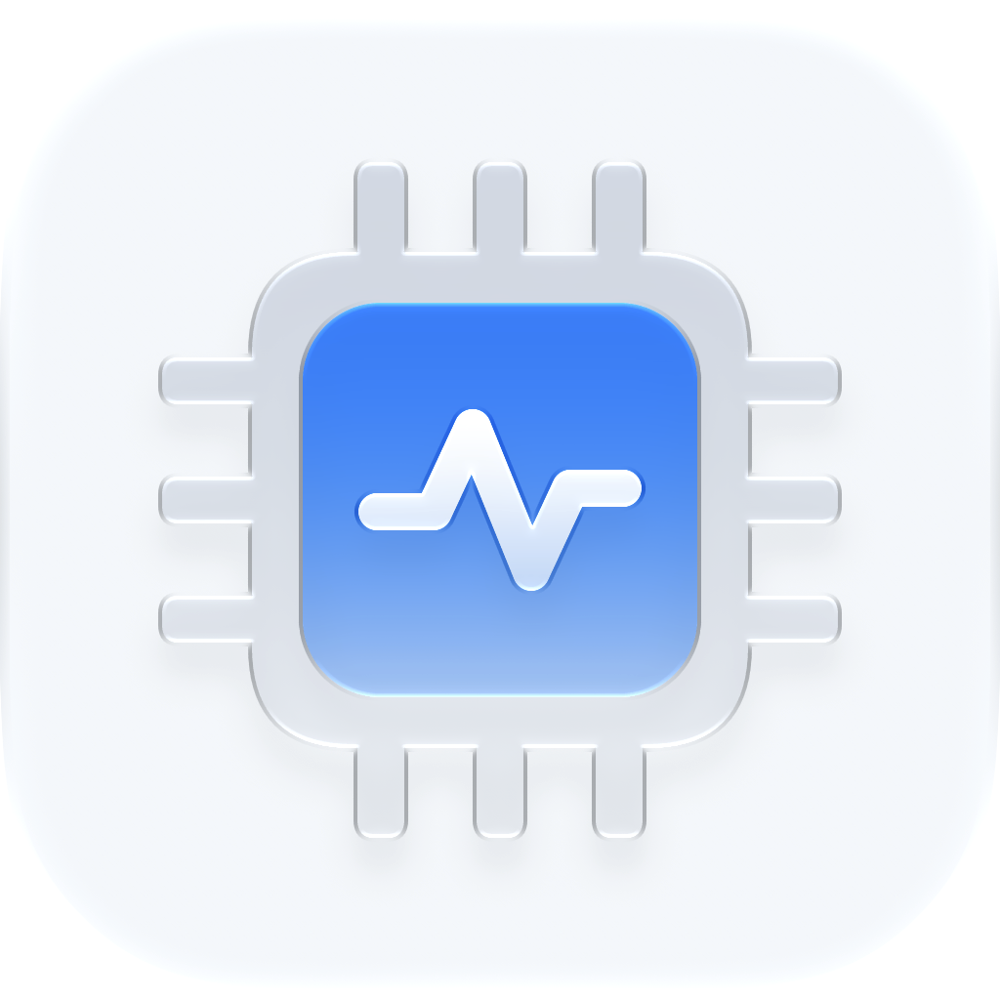
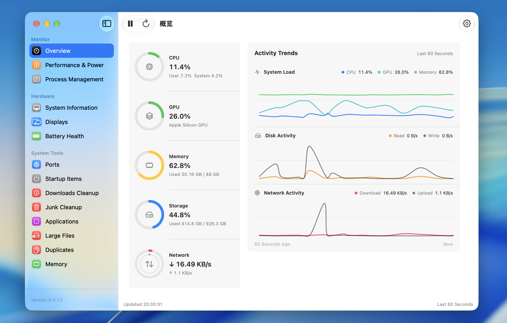
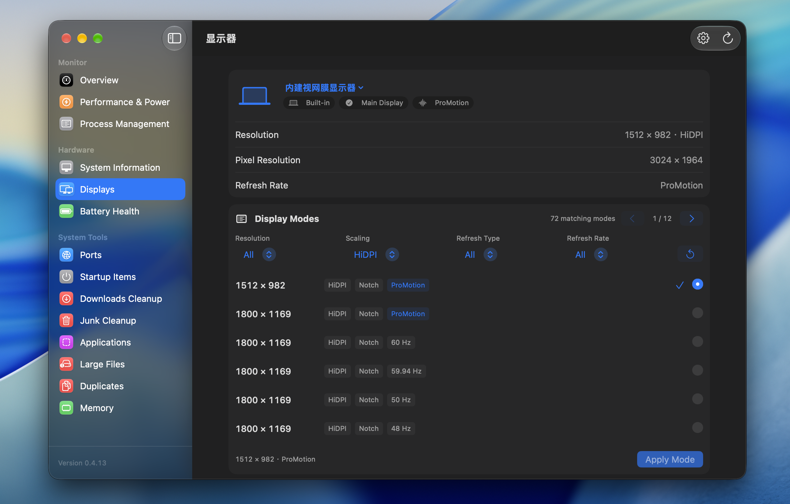

<p align="center">
  
</p>

<h1 align="center">MacScope</h1>

<p align="center">
  <a href="README.md">English</a> · <a href="README.zh-CN.md">简体中文</a> · <strong>繁體中文</strong> · <a href="README.ja.md">日本語</a> · <a href="README.ko.md">한국어</a>
</p>

<p align="center">
  <strong>專為 macOS 打造的輕量系統監控與維護工具</strong>
</p>

<p align="center">
  掌握資源使用情況、管理執行中的程序、釋放磁碟空間，完整移除應用程式。
</p>

<p align="center">
  <a href="https://github.com/shenmuoso/mac-scope/releases"><strong>下載最新版本</strong></a>
  ·
  <a href="#features">功能介紹</a>
  ·
  <a href="https://github.com/shenmuoso/mac-scope/issues">回報問題</a>
</p>

<p align="center">
  
  
  
  
</p>

> [!TIP]
> **0.5.1：選單列看板最佳化與維護穩定性改善。** 看板採用系統字體、更清楚的文字層級與緊湊配置；視窗標題與程序確認對話框隨語言切換，清理選取控制項補上輔助使用標籤，已取消工作的回呼不會覆蓋新工作的狀態。

MacScope 將 Mac 最值得關注的狀態集中在清楚的原生介面中。以 SwiftUI 與 AppKit 建構，不含 Electron、內嵌瀏覽器或額外執行環境；不需要終端機、Python 或 Homebrew，安裝後即可使用。





## 為什麼選擇 MacScope

| | 使用體驗 |
| --- | --- |
| **原生介面** | 標準 macOS 視窗、選單、表格、設定、授權對話框與深淺色外觀 |
| **輕量直接** | 體積小、無額外執行環境，不必為了查看資源用量而執行龐大的網頁容器 |
| **資訊集中** | CPU、功耗、溫度、風扇、記憶體、磁碟、網路、程序與維護工具整合於同一應用程式 |
| **操作透明** | 清楚呈現掃描結果、檔案路徑、處理進度與失敗原因，由你決定刪除項目 |
| **本機優先** | 監控與檔案分析均在本機完成，不上傳系統狀態或掃描結果 |

<a id="features"></a>

## 核心功能

### 原生選單列監控

不必一直開著主視窗，也能隨時掌握 Mac 的狀態。

- 僅顯示黑白剪影圖示，或精簡顯示最多三個即時指標。
- 自由選擇 CPU、GPU（Apple Silicon）、記憶體、磁碟、網路、溫度、整機功耗與充電功率，並調整順序；GPU 與功耗指標預設關閉。
- 網路上傳與下載速率分兩行顯示；指標採固定寬度，數值變化不會擠動其他選單列圖示。
- 點擊圖示展開面板，查看最近一分鐘的活動趨勢。
- 查看依 CPU、記憶體、磁碟或網路用量排序的高用量程序。
- 自訂面板模組與程序數量；關閉主視窗後仍可繼續監控。
- 面板預設採單色樣式，也可開啟「彩色模式」，僅為圖表與動態狀態加入色彩。
- 游標進入面板後移出約 0.25 秒自動關閉，可在「設定 > 選單列」中關閉此行為。
- 主視窗、設定與說明皆採左側連續透明材質、右側實色背景。macOS 26+ 的側邊欄、選單列面板與結果對話框使用原生 Liquid Glass，並依外觀調整閱讀底色。在「設定 > 外觀 > Liquid Glass」中選擇「玻璃、均衡、霧面」，立即生效並自動儲存。
- 原生標題列與灰底分組整理詳細頁面；資訊頁面採用 SwiftUI 分組表單，表格工作區統一間距與狀態列，減少分隔線與外框。
- 較舊系統使用原生模糊材質，所有材質皆遵循系統的降低透明度與增加對比設定。
- 可在「設定 > 外觀」隱藏 Dock 圖示。隱藏後仍可從選單列開啟視窗與設定，但不會出現在應用程式切換器中；Dock 與選單列至少保留一個入口。
- Dock 圖示預設跟隨應用程式外觀；採用「跟隨系統」時，也隨系統切換深淺色。可在「設定 > 外觀 > Dock 圖示」單獨選擇淺色或深色。Finder 圖示外觀由 macOS 圖像樣式設定控制。

### 即時資源監控

Mac 發熱、風扇加速或網路變慢時，不再只能猜測原因。

- **CPU：** 總用量、使用者用量、系統用量與 SoC 溫度。
- **GPU（僅 Apple Silicon）：** 總用量與最近 60 秒趨勢；系統提供資料時可查看算繪與區塊處理用量，不需管理員權限。
- **記憶體：** 已用、總量、可用容量與即時使用比例。
- **磁碟：** 資料卷宗容量、讀取與寫入速率。
- **網路：** 即時下載與上傳速率。
- **概覽：** 左側環形指標顯示目前狀態，右側整合曲線比較最近 60 秒的系統負載、磁碟與網路活動。
- **動態狀態色：** 依使用率、網速與溫度區間快速辨識狀態。
- **彈性更新：** 支援暫停、立即重新整理，以及 `0.5`、`1`、`2`、`5` 秒更新間隔。

### 效能、功耗與散熱

在同一頁面比較高負載、溫度變化與風扇行為。

- 同時查看 CPU 與 GPU 用量、整機功耗、充電功率、電源轉接器輸入、SoC 溫度與風扇轉速。
- 以獨立的 60 秒趨勢圖呈現 CPU、GPU、功耗、溫度與散熱變化。
- 列出各風扇目前、最低與最高轉速；無風扇機型與無法取得感測資料的情況會明確標示。
- 偵測為無風扇的 Mac 會隱藏風扇控制區域；配有風扇的舊款 Intel MacBook Air 仍會保留。
- 在可讀取並驗證風扇目標值的機型上，可啟用 15、30 或 60 分鐘「最大散熱」，並透過 macOS 原生管理員對話框授權。
- 最大散熱會將所有風扇一起提升至硬體回報的最高轉速，不提供任意轉速控制，也不降低 macOS 選定的風扇速度。
- 整機功耗與充電功率可加入選單列精簡指標或面板，兩者預設皆關閉。

### 程序監控與管理

獨立的程序表格讓你看清資源用量，並直接採取行動。

- 查看程序名稱、PID、CPU、記憶體、磁碟讀寫、網路傳輸、執行緒數量與執行時間。
- 點擊欄位標題以遞增或遞減排序；大量程序採預先計算的排序值，避免依記憶體等欄位排序時介面卡住。
- 區分系統軟體或服務、已安裝應用程式、外掛或工具及其他來源，並依來源篩選。
- 依應用程式分組，彙總 CPU、記憶體、磁碟與網路用量；展開後仍可排序子程序。
- 依程序、應用程式名稱、Bundle ID 或 PID 搜尋，可顯示前 5、10、20 或 50 筆。
- 按兩下程序查看最近一分鐘的 CPU、記憶體與 I/O 趨勢。
- 支援結束與強制結束程序，執行前會要求確認。

### 系統硬體與電池健康度

集中查看硬體、顯示器與連線資訊，不必逐層尋找系統報告。

- 顯示 Mac 型號、晶片、架構、CPU 核心、記憶體、系統版本、運作時間與熱狀態。
- 列出內建與外接顯示器、邏輯與像素解析度，以及主顯示器狀態。
- 查看 USB 裝置、藍牙控制器與已連線裝置，以及 Wi-Fi 介面、訊號、速率與頻道。
- MacBook 可查看電量、最大與設計容量、循環次數、電池狀態、溫度、電壓與電流。
- 不支援的欄位維持無法取得，不以估算值代替真實讀數。

### 顯示器控制

- 在硬體群組中切換顯示器；單一原生分組表單整合目前模式、模式選擇、硬體調整與色彩描述檔。篩選條件維持同一行，模式清單採分頁呈現。
- 結合邏輯解析度、HiDPI、更新類型與更新率篩選；逐列顯示解析度、縮放、長寬比與更新率標籤。符合內建瀏海螢幕比例的模式標示為 Notch；切換後提供 15 秒確認與自動還原。
- 補齊公開模式清單未列出的原生 HiDPI 模式，即使從較低解析度啟動也可直接選擇；切換後驗證實際輸出，還原失敗時保留原模式以供重試。
- 依系統資料區分 ProMotion、其他可變更新率與固定更新率。固定 120 Hz 不會標示為 ProMotion，59.94 Hz 等小數更新率保留精度。
- 調整內建螢幕原始背光，以及支援 DDC/CI 外接螢幕的亮度、對比與音量。拖曳時立即更新百分比，背景合併寫入並驗證；失敗時還原已確認值，未取得有效回覆的控制項維持無法使用。
- 切換已安裝的 RGB 顯示器 ICC 描述檔，或還原目前顯示器的系統預設描述檔。
- 完整模式列舉與切換、ProMotion 辨識、內建背光與 Apple Silicon DDC 使用執行時偵測的非公開系統介面，可能受 macOS 更新影響。ICC 使用 ColorSync；Intel DDC 使用 IOKit I2C。螢幕、線材與轉接器皆可能影響 DDC 支援。

### 連接埠與下載工具

- **連接埠使用情況：** 查看 TCP 與 UDP 監聽埠、位址、PID、程序與所屬應用程式；支援篩選、複製、開啟本機位址與結束程序。
- **下載項目清理：** 分類掃描安裝套件、壓縮檔、重複下載、未完成下載、大型檔案與舊檔案。
- 透過內容雜湊驗證重複下載，並確保每組至少保留一份。
- 「建議選取」僅選取未完成下載、較舊安裝套件或壓縮檔，以及重複檔案中的舊副本。
- 下載檔案一律在確認後移至垃圾桶，不會自動永久刪除。

### 啟動項目管理

分開呈現「登入時開啟」、背景工作與失效啟動設定，避免混淆執行狀態與啟動許可。

- 讀取 macOS「登入時開啟」項目，支援加入、移除與定位應用程式。
- 掃描使用者與第三方 `launchd` 背景工作，顯示許可、執行狀態、觸發方式與所屬應用程式。
- 將目標遺失、設定異常或應用程式已移除的項目集中於「需要處理」，確認後再停用或移除。
- 保守處理系統項目、共用設定與關聯不明的項目，不會預設選取刪除。

### 垃圾掃描與清理

先看清找到的內容，再決定移除哪些項目。

- 掃描使用者快取、日誌、診斷報告與開發者檔案。
- 依類別查看大小、路徑與個別項目，支援逐項選取。
- 清理時顯示目前檔案與整體進度；完成後顯示精簡摘要，獨立結果視窗提供逐項狀態、路徑與失敗原因。
- 快取可選擇移至垃圾桶或永久刪除，預設採垃圾桶模式。
- 失敗項目保留明確原因，解決權限問題後可重試。

### 應用程式移除與殘留清理

在同一確認流程檢查應用程式本體與相關資料。

- 掃描標準應用程式目錄，顯示狀態、位置與大小。
- 辨識 Bundle ID、相關資料與系統已登錄的其他副本。
- 分析相關登入項目、啟動代理程式與背景設定，區分確定、可能及共用關聯。
- 在獨立確認介面檢查應用程式、每一項殘留檔案與可移除的啟動設定。
- 顯示移除路徑與即時進度；獨立結果視窗集中呈現成功項目、失敗原因與權限處理入口。
- 移除 `/Applications` 中受保護的應用程式時，確認後立即顯示 macOS 原生管理員授權對話框，不必先失敗再重試。
- 先確認應用程式本體可移除，再處理相關資料，避免留下資料已清空但仍存在的應用程式。

### 磁碟與資源管理

找出磁碟空間的去向。

| 工具 | 用途 |
| --- | --- |
| **大型檔案** | 在指定資料夾尋找超過門檻的檔案，依大小定位空間用量 |
| **重複檔案** | 透過大小與內容雜湊確認重複項，確保每組至少保留一份 |
| **快速釋放記憶體** | 透過 macOS 原生管理員授權，請求系統回收符合條件的非作用中檔案快取，不關閉執行中的應用程式 |

大型檔案與重複檔案預設掃描使用者的 `Downloads`、`Desktop`、`Documents` 與 `Movies`；可在設定中加入或移除掃描資料夾。

## 常見使用情境

- **Mac 突然發熱：** 依 CPU 排序，找出持續高用量的程序，查看最近一分鐘活動。
- **記憶體壓力升高：** 依記憶體排序找出主要使用者，必要時快速釋放記憶體。
- **磁碟空間不足：** 檢查垃圾、大型檔案與重複檔案，列出可回收空間。
- **應用程式移除不完整：** 檢查相關資料與其他副本，再統一確認移除。
- **快速查看狀態：** 在選單列顯示 CPU、記憶體或網速。
- **連接埠被占用：** 搜尋埠號找到應用程式，開啟本機位址或結束程序。
- **發熱或風扇加速：** 比較 CPU、功耗、溫度與風扇曲線，觀察負載與散熱的關係。
- **啟動項目殘留：** 在「需要處理」中檢查目標已不存在的登入項目或背景設定。
- **下載資料夾雜亂：** 分類檢查安裝套件、壓縮檔、重複下載與舊檔案。
- **確認硬體狀態：** 集中查看晶片、記憶體、顯示器、無線連線與電池健康度。

## 下載與安裝

1. 從 [GitHub Releases](https://github.com/shenmuoso/mac-scope/releases) 下載最新的 `MacScope-*.dmg`。
2. 開啟 DMG，將 `MacScope.app` 拖入 `Applications` 資料夾。
3. 從「應用程式」啟動 MacScope。

> [!IMPORTANT]
> 目前版本使用 ad-hoc 開發簽章，尚未完成 Apple Developer ID 公證。請只開啟從本儲存庫 Releases 頁面下載的安裝套件。MacScope 不會要求你在應用程式自己的介面輸入管理員密碼。

### 首次開啟 MacScope

若 macOS 無法驗證開發者或阻擋開啟：

1. 確認 `MacScope.app` 已放入「應用程式」，並嘗試開啟一次。
2. 點擊「完成」或關閉系統提示。
3. 開啟 Apple 選單 > 系統設定 > 隱私權與安全性。
4. 捲動至安全性區域，找到 MacScope 被阻擋的提示。
5. 點擊「強制打開」，使用 Touch ID 或管理員密碼確認。
6. 在最後的確認對話框點擊「打開」。同一版本通常不需重複確認。

也可在 Finder 的「應用程式」中以右鍵點擊 `MacScope.app`，選擇「打開」並再次確認。更換不同 ad-hoc 簽章的版本後，可能需要重新確認。

## 個人化設定

介面偏好透過 macOS `UserDefaults` 儲存；登入啟動與隱私權限由 macOS 管理。

| 類別 | 選項 |
| --- | --- |
| **監控** | 0.5/1/2/5 秒更新間隔、前 5/10/20/50 筆程序、攝氏或華氏 |
| **選單列** | 啟用開關、僅圖示或精簡指標、最多三項指標、功耗指標、模組順序、程序排序與數量、彩色模式 |
| **外觀** | 跟隨系統、淺色、深色、強調色、玻璃/均衡/霧面材質、透明側邊欄、Dock 圖示顯示與外觀 |
| **清理** | 快取處理方式、執行前確認、大型與重複檔案門檻、下載檔案時間範圍、掃描資料夾 |
| **權限管理** | 登入時開啟、完整磁碟存取設定、按需管理員授權說明 |
| **應用程式語言** | 英文或簡體中文；預設為英文 |

系統將設定儲存於：

```text
~/Library/Preferences/com.shenmuoso.macscope.plist
```

## 隱私、權限與安全

- 系統指標、程序資訊與掃描結果僅在本機處理，不會上傳。
- 更新檢查僅向 GitHub 請求最新版本資訊；有新版時在側邊欄底部顯示下載入口。
- 檔案預設移至垃圾桶，MacScope 不會自動清空垃圾桶。
- 應用程式、殘留檔案、大型檔案與重複檔案一律移至垃圾桶，不直接永久刪除。
- 下載清理僅掃描使用者的 `Downloads`，清理前一律顯示類別、路徑、大小與修改日期。
- 只有可重建的快取與開發者檔案，才可在設定允許時永久刪除。
- 部分使用者資料庫路徑需「完整磁碟存取」權限，可從「設定 > 權限管理」開啟系統設定。
- 移除受保護的應用程式或釋放檔案快取時，執行前立即顯示標準 macOS 管理員授權對話框。
- 啟動或還原風扇控制也使用相同系統對話框；經雜湊驗證的暫存 Helper 從 `/var/tmp` 執行，結束後移除，不安裝常駐 root 服務。
- MacScope 不讀取、接收或儲存管理員密碼。
- 掃描略過符號連結與應用程式套件內部，避免超出所選資料夾範圍。

### 啟用完整磁碟存取

1. 在 MacScope 開啟「設定 > 權限管理 > 開啟完整磁碟存取設定」。
2. 在系統設定開啟 MacScope 旁的開關。
3. 若已開啟但仍無法存取，先使用 `−` 移除，再以 `+` 重新加入 `/Applications/MacScope.app`。
4. 結束並重新開啟 MacScope。

目前採 ad-hoc 簽章，更換測試版本可能改變程式身分，而 macOS 仍保留舊權限項目；因此可能需要移除後重新加入。

## 系統需求

- macOS 13 Ventura 或更新版本。
- 目前 GitHub Release DMG 適用於 Apple Silicon；Intel Mac 可使用相容的 Swift 工具鏈從原始碼建構。
- 原生應用程式不需 Python、Textual、Homebrew 或其他執行環境。
- 溫度讀取取決於機型與 macOS 提供的 IOHID 感測器；無法取得溫度時，其他監控功能仍可使用。

## 常見問題

### 為什麼首次取樣的 CPU、磁碟或網路速率為零？

速率需要比較兩次系統計數才能計算，等待一個更新週期即可顯示即時數值。

### 為什麼部分檔案需要完整磁碟存取？

macOS 保護部分使用者資料庫目錄。MacScope 會回報權限問題，不會繞過系統保護；授權後重新掃描即可。

若開關已啟用但掃描仍受限，請移除權限項目，重新加入 `/Applications/MacScope.app`，再重新啟動 MacScope。

### MacScope 看得到管理員密碼嗎？

不會。密碼對話框與驗證流程由 macOS 處理，MacScope 只接收授權結果。

### 為什麼溫度無法取得？

不同 Mac 與 macOS 版本提供的感測器不同，不影響 CPU、記憶體、磁碟、網路與程序監控。

### 為什麼功耗或風扇讀數無法取得？

MacScope 僅顯示硬體與 macOS 實際提供的感測資料；無風扇、未接電源或未提供讀數時，不會以估算值代替。

### 為什麼最大散熱無法使用？

只有在能讀取風扇數量、硬體最高轉速與目標轉速，並在授權後回讀驗證寫入結果時，才開放控制。無風扇 Mac 隱藏控制區域；未知 SMC 格式或系統拒絕寫入時維持唯讀。此實驗性功能依賴 Apple 非公開 SMC 介面，可能因機型或 macOS 更新而無法使用。

## 從原始碼建構

需要 macOS 13+、Xcode Command Line Tools，建議使用 Swift 6 工具鏈。

```bash
git clone git@github.com:shenmuoso/mac-scope.git
cd mac-scope
native/scripts/run_app.sh debug
```

僅建構原生應用程式：

```bash
native/scripts/build_app.sh release
```

建構發布用 DMG：

```bash
native/scripts/build_dmg.sh release
```

預設輸出：

```text
native/build/MacScope-0.5.1.dmg
```

儲存庫保留早期 Python/Textual 終端版本，供相容性與歷史參考；它不是原生應用程式的執行相依項目。

## 專案與回饋

- [下載與版本歷史](https://github.com/shenmuoso/mac-scope/releases)
- [回報問題或提出功能建議](https://github.com/shenmuoso/mac-scope/issues)
- [專案首頁](https://github.com/shenmuoso/mac-scope)
- [作者首頁](https://github.com/shenmuoso)
